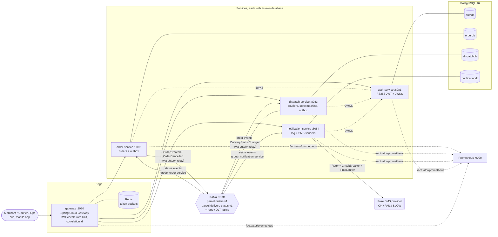
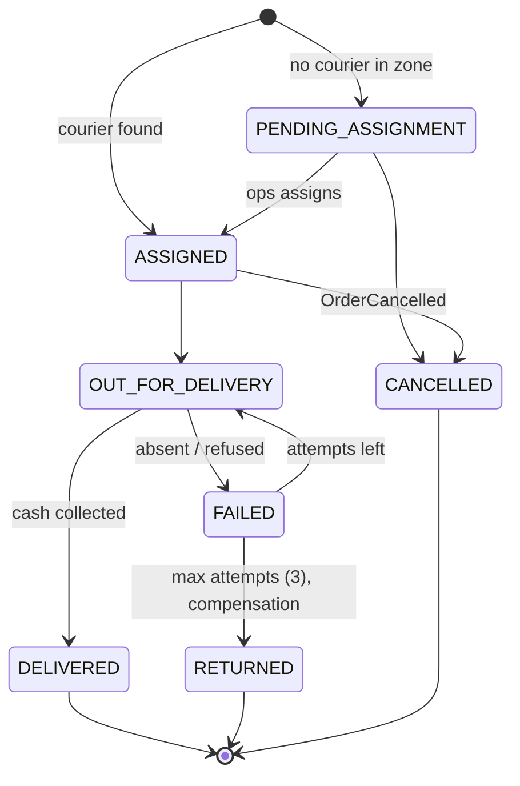

# spring-parcel-platform

An event-driven parcel delivery platform for **cash-on-delivery (COD) e-commerce**, built with
**Java 21, Spring Boot 3.3, Spring Cloud Gateway, Spring Kafka, PostgreSQL, Redis, Resilience4j,
Micrometer/OpenTelemetry and Testcontainers**.

The domain comes from real COD logistics in Morocco. Merchants create orders. A warehouse dispatches
parcels to couriers by zone. Couriers go out, deliver and collect the cash, or fail, retry, and finally
return the parcel to the merchant. Customers get an SMS at each step.

> Companion docs: [docs/INTERVIEW-GUIDE.md](docs/INTERVIEW-GUIDE.md) has diagrams, a NestJS-to-Spring
> mapping, a file-by-file trace of one order, and 30 interview questions answered with this code.

---

## The problem

COD delivery has a few hard properties:

* **Several teams and systems own different parts of a parcel's life.** Order intake, dispatch and
  customer messaging change at different speeds and scale differently.
* **No step may be lost.** If an order is saved but the "new order" message is lost, a parcel sits in
  the warehouse forever. A bank-style distributed transaction (2PC) across a database and Kafka is not
  available, and it would not be wanted anyway.
* **Messages arrive more than once.** Kafka, retries and crashes all mean a consumer can see the same
  event twice. Assigning a courier twice, or sending two "your parcel is delivered" SMS, is a bug.
* **External providers fail.** The SMS gateway will be slow or down at some point. That must not stop
  deliveries.
* **Failed deliveries are normal.** In COD, a large share of first attempts fail (customer absent,
  refused, phone off). After N attempts the parcel goes back to the merchant. That is a long-running
  business process, not one transaction.

## Architecture



| Module | Responsibility | Tech highlights |
|---|---|---|
| `gateway` | Single entry point | Spring Cloud Gateway (WebFlux), OAuth2 resource server, Redis `RequestRateLimiter`, correlation-id filter |
| `auth-service` | Users and tokens | BCrypt, RS256 `JwtEncoder`, `/.well-known/jwks.json`, Postgres + Flyway |
| `order-service` | COD orders | JPA + Flyway, **transactional outbox**, idempotent projection of delivery status, `Idempotency-Key` header |
| `dispatch-service` | Couriers and deliveries | Zone-based assignment, explicit **state machine**, `@RetryableTopic` (retry topic + DLT), outbox |
| `notification-service` | Customer messages | Pluggable `NotificationSender`s, **Resilience4j** (Retry, CircuitBreaker, TimeLimiter) around the SMS API |
| `common-events` | Event contracts | Versioned records (`OrderCreatedV1`, ...), envelope, tolerant JSON codec |
| `service-support` | Shared platform code | Outbox writer and relay, idempotency guard, correlation id across HTTP and Kafka, ProblemDetail errors, JWT roles |

### Event flow: one order, happy path

```mermaid
sequenceDiagram
    autonumber
    actor M as Merchant
    participant GW as gateway
    participant O as order-service
    participant ODB as orderdb
    participant K as Kafka
    participant D as dispatch-service
    participant DDB as dispatchdb
    participant N as notification-service
    actor C as Courier

    M->>GW: POST /api/orders (Bearer JWT)
    GW->>GW: validate JWT, rate limit, add X-Correlation-Id
    GW->>O: forward
    O->>ODB: BEGIN; INSERT order; INSERT outbox(OrderCreated); COMMIT
    O-->>M: 201 Created (status CREATED)
    loop every 300 ms
        O->>ODB: SELECT ... FOR UPDATE SKIP LOCKED
        O->>K: send parcel.orders.v1 key=orderId
        O->>ODB: mark published
    end
    K->>D: OrderCreated
    D->>DDB: BEGIN; INSERT processed_event; INSERT delivery; pick courier in zone; INSERT outbox(ASSIGNED); COMMIT
    D->>K: DeliveryStatusChanged(ASSIGNED) via relay
    par two consumer groups, two copies
        K->>O: ASSIGNED -> order status ASSIGNED
    and
        K->>N: ASSIGNED -> SMS "assigned to a courier"
    end
    C->>GW: POST /api/deliveries/{id}/out-for-delivery
    GW->>D: forward
    D->>K: OUT_FOR_DELIVERY (outbox)
    K->>N: SMS "prepare 249.90 MAD in cash"
    C->>GW: POST /api/deliveries/{id}/delivered
    D->>K: DELIVERED (outbox)
    K->>O: order DELIVERED
    K->>N: SMS "delivered, 249.90 MAD received"
```

### Failed delivery: saga with a compensating step



---

## Run it

Requirements: Docker (with BuildKit) and, for local builds, JDK 21. Everything else comes from the
Maven wrapper.

```bash
# build + all tests (unit + Testcontainers: Postgres, Kafka KRaft, Redis)
./mvnw verify

# full stack: Kafka (KRaft), Postgres, Redis, 5 services, Prometheus
docker compose up -d --build
docker compose ps            # wait until the services are "healthy" (about 1 minute)

# optional: Jaeger (traces, http://localhost:16686) + Grafana (http://localhost:3001)
docker compose -f docker-compose.yml -f docker-compose.observability.yml up -d

# tear down (and delete volumes)
docker compose down -v
```

| URL | What |
|---|---|
| http://localhost:8080 | gateway (use this for everything) |
| http://localhost:8082/swagger-ui.html | order-service OpenAPI (also 8081, 8083, 8084) |
| http://localhost:9090 | Prometheus (try `parcel_outbox_pending`, `parcel_orders_placed_total`, `resilience4j_circuitbreaker_state`) |
| localhost:9094 | Kafka for host tools |
| localhost:15432 | Postgres (`parcel` / `parcel`) |

Memory: each JVM runs with `-XX:MaxRAMPercentage=55 -XX:+UseSerialGC -XX:TieredStopAtLevel=1` inside a
360 MB container limit. Kafka gets a 256 MB heap. The whole stack fits in about 2 GB.

Demo users (password `Passw0rd!`): `ops`, `merchant.atlas` (M-1001), `merchant.souk` (M-1002),
`courier.casa1`, `courier.casa2`, `courier.rabat1`.

## curl walkthrough

`./scripts/demo.sh` runs these steps for you (`./scripts/demo.sh --fail` runs the return flow).

```bash
GW=http://localhost:8080

# 1. log in
MERCHANT=$(curl -s $GW/api/auth/login -H 'Content-Type: application/json' \
  -d '{"username":"merchant.atlas","password":"Passw0rd!"}' | jq -r .accessToken)
OPS=$(curl -s $GW/api/auth/login -H 'Content-Type: application/json' \
  -d '{"username":"ops","password":"Passw0rd!"}' | jq -r .accessToken)

# 2. create a COD order (Idempotency-Key makes a retried POST safe)
ORDER_ID=$(curl -s $GW/api/orders -H "Authorization: Bearer $MERCHANT" \
  -H 'Content-Type: application/json' -H 'Idempotency-Key: order-001' -H 'X-Correlation-Id: demo-1' \
  -d '{"recipientName":"Salma Idrissi","recipientPhone":"+212612345678",
       "addressLine":"12 Rue Atlas, Maarif","city":"Casablanca","codAmount":249.90}' | jq -r .id)

# 3. within a second, dispatch has assigned a Casablanca courier
curl -s $GW/api/orders/$ORDER_ID -H "Authorization: Bearer $MERCHANT" | jq .status      # "ASSIGNED"
curl -s $GW/api/deliveries/$ORDER_ID -H "Authorization: Bearer $OPS" | jq '{zone,courierId,status}'

# 4. the courier (courier.casa1 on a fresh stack) drives the delivery
COURIER=$(curl -s $GW/api/auth/login -H 'Content-Type: application/json' \
  -d '{"username":"courier.casa1","password":"Passw0rd!"}' | jq -r .accessToken)
curl -s -X POST $GW/api/deliveries/$ORDER_ID/out-for-delivery -H "Authorization: Bearer $COURIER" | jq .status
curl -s -X POST $GW/api/deliveries/$ORDER_ID/delivered       -H "Authorization: Bearer $COURIER" | jq .status

# 5. the merchant sees the final status (eventual consistency, a few hundred ms)
curl -s $GW/api/orders/$ORDER_ID -H "Authorization: Bearer $MERCHANT" | jq .status      # "DELIVERED"

# 6. notifications (log + fake SMS provider)
curl -s "$GW/api/notifications?orderId=$ORDER_ID" -H "Authorization: Bearer $OPS" | jq -r '.[] | "\(.channel) \(.status) \(.message)"'
docker compose logs notification-service | grep "NOTIFY \[LOG\]"

# 7. one correlation id across gateway -> order -> Kafka -> dispatch -> Kafka -> notification
docker compose logs | grep demo-1

# 8. break the SMS provider and watch the circuit breaker open (log channel keeps working)
curl -s -X POST localhost:8084/fake-sms/admin/mode/FAIL
#    ... create and deliver a few orders, then:
curl -s localhost:8084/actuator/prometheus | grep 'resilience4j_circuitbreaker_state{.*state="open"'
curl -s -X POST localhost:8084/fake-sms/admin/mode/OK
```

Errors come back as RFC 9457 problem details, with the correlation id:

```json
{
  "type": "https://parcel.benzaazaa.com/problems/validation",
  "title": "Validation failed",
  "status": 400,
  "detail": "One or more fields are invalid",
  "errors": { "recipientPhone": "must be a Moroccan number like +212612345678" },
  "correlationId": "demo-1"
}
```

---

## Design decisions

### Why the transactional outbox?
Saving an order and publishing `OrderCreated` are two writes to two systems (the **dual-write
problem**). Writing to the database and then calling Kafka loses the event if the process crashes
between the two. Calling Kafka first and then failing the DB commit publishes an order that does not
exist. The outbox removes the problem: the event is a row in the **same local transaction** as the
order (`OutboxWriter` uses `Propagation.MANDATORY`, so calling it outside a transaction fails). A
relay (`OutboxRelay`) publishes committed rows and marks them as sent. It uses
`SELECT ... FOR UPDATE SKIP LOCKED` so several replicas can run without double-publishing or blocking
each other. It stops at the first failure so a later event never overtakes an earlier one for the
same order. Debezium CDC on the WAL is the production-grade alternative to polling.

### Why idempotent consumers?
The outbox gives **at-least-once** delivery: if the relay crashes after Kafka acked but before the
UPDATE commits, the row is sent again. Kafka can also redeliver after a rebalance or a crash before
the offset commit. So every consumer records `(eventId, consumer)` in `processed_event` using
`INSERT ... ON CONFLICT DO NOTHING`, **in the same transaction as the business change**. A duplicate
inserts 0 rows and is skipped. Two concurrent copies serialise on the primary key. The delivery
table also has `UNIQUE(order_id)` as a second guard.

### At-least-once plus idempotence, not "exactly-once"
Kafka transactions (EOS) give exactly-once only for read-from-Kafka, write-to-Kafka pipelines. Here
every step also writes to Postgres, so the reliable recipe is **at-least-once delivery + idempotent
processing = effectively-once effects**.

### Ordering
Every event is keyed by `orderId`, so all events of one order go to the same partition and are read
in order. Two things can still reorder them: the non-blocking retry topic in dispatch, and
redeliveries. So `DeliveryStatusChanged` carries a per-delivery `sequence`, and order-service ignores
anything older than what it has already applied.

### Two retry styles, on purpose
* **order-service and notification-service** use a *blocking* `DefaultErrorHandler`: 3 retries with
  exponential backoff in place, then the record goes to `<topic>.<group>-dlt`. This keeps partition
  order but holds up the partition while it retries.
* **dispatch-service** uses *non-blocking* `@RetryableTopic`: a failing record moves to
  `parcel.orders.v1-retry` and the partition keeps flowing. After 4 attempts it goes to
  `parcel.orders.v1-dlt`. This favours throughput over strict ordering, which is safe here because
  the handler is idempotent.
* **Poison messages** (malformed JSON, missing fields, a schema version from the future) throw
  `InvalidEventException`, which is marked non-retryable. They go straight to the DLT.

### Eventual consistency
`POST /api/orders` returns `CREATED` right away. The order becomes `ASSIGNED` a few hundred
milliseconds later, once the events have gone round. The merchant view is a **projection** of the
dispatch facts. When they disagree (a cancel racing a courier who has already left), the field
outcome wins: a cancelled order still accepts `DELIVERED` or `RETURNED`.

### Saga: failed delivery leads to return
The parcel's life is a **choreographed saga**: no central orchestrator, and each service reacts to
events. The compensating step is `RETURNED`. After the last allowed attempt fails,
`Delivery.markFailed` emits `FAILED` and then `RETURNED`. order-service marks the order as returned,
notification-service tells the customer, and (in a real system) a settlement service would not
expect cash for it. An orchestrator (Temporal, or a Spring State Machine process manager) would make
sense once the flow has more branches and timeouts.

### Resilience at the SMS edge
`SmsGatewayClient` composes **Retry(CircuitBreaker(TimeLimiter(http call)))**, the same order as the
Resilience4j annotations, but written out so you can read it and unit-test it. 4xx responses are not
retried (our request is wrong). 5xx, IO errors and timeouts are retried with backoff. When more than
50% of the last 10 calls failed, the breaker opens for 30 s and calls return `SKIPPED` immediately.
Senders never throw, so a dead provider cannot cause a storm of Kafka redeliveries, and the log
channel keeps working.

### Security
`auth-service` signs RS256 JWTs with a private key that only it holds and publishes the public key
as a JWKS. The gateway **and** every service validate tokens locally (signature, expiry, issuer):
defence in depth, and no per-request call to auth-service. Coarse authentication happens at the
edge; role and ownership rules (`@PreAuthorize`, "a courier can only drive their own deliveries", "a
merchant only sees their own orders", returned as 404 so other orders' existence is not revealed)
live in the services.

### Observability
* Actuator + Micrometer + Prometheus on every service, with business metrics:
  `parcel.orders.placed`, `parcel.outbox.pending`, `parcel.deliveries.status.changed{status}`,
  `parcel.notifications{channel,result}`, `parcel.dispatch.dead-letters`, plus Resilience4j metrics.
* Micrometer Tracing (OpenTelemetry bridge): `traceId`/`spanId` are in every log line and propagate
  over HTTP and Kafka (`observation-enabled`). Export to Jaeger with the observability overlay.
* A business **correlation id** (`X-Correlation-Id`) is created at the gateway, stored in the MDC,
  saved in the outbox row and copied into the `x-correlation-id` Kafka header. A record interceptor
  restores it on the consumer side. One `grep` follows an order across all services, even across
  the asynchronous outbox hop where the trace context is not kept.

### Other choices worth defending
* **Database per service** (here, one Postgres instance with four databases to save laptop RAM).
  Services share data only through events and APIs.
* **Event-carried state transfer**: `DeliveryStatusChanged` includes the phone number and COD amount,
  so notification-service never calls order-service.
* **Tolerant reader**: unknown JSON fields are ignored and unknown enum values map to `UNKNOWN`, so
  producers can add fields without breaking consumers. Breaking changes get a new `V2` record or a
  new topic.
* **Money** is `BigDecimal`/`NUMERIC(10,2)` end to end. The JSON codec even keeps exact decimals in
  its tree model.
* **Optimistic locking** (`@Version`) on orders and deliveries, so two couriers tapping at the same
  time cannot both win (409 ProblemDetail).

## Tests

`./mvnw verify` runs **138 tests**. Docker is needed for the integration tests.

| Kind | Examples |
|---|---|
| Domain unit tests (JUnit 5, parameterized) | delivery transition table, attempts leading to RETURNED, cancellation window, stale sequence ignored, least-loaded courier choice, city-to-zone mapping, message templates, codec compatibility |
| Service tests (Mockito) | outbox event appended, duplicate event is a no-op, idempotent replay of POST, courier ownership |
| Web slice tests (`@WebMvcTest` + `jwt()`) | 401, 403, 400 with field errors and correlation id, 409 business rule, 201 + Location |
| Testcontainers (Postgres + Kafka KRaft) | outbox to Kafka with key and headers; same event twice has one effect; poison message to DLT without retries; transient failure recovered via the retry topic; correlation id survives Kafka to service to outbox to Kafka |
| Resilience | retry on 503, no retry on 4xx, TimeLimiter cut-off, circuit opens and short-circuits (stub HTTP server); provider outage opens the breaker in the full Spring context while the log channel keeps sending |
| Gateway (Testcontainers Redis) | 401 without token, wrong issuer or foreign key rejected, routing with headers, 429 above the token bucket |

## What I would do next

* **Kubernetes**: Helm chart, readiness and liveness probes (already exposed), HPA on consumer lag
  (KEDA), and Kafka through Strimzi.
* **Schema Registry + Avro or Protobuf** instead of JSON, with compatibility checks in CI. The
  envelope already carries `schemaVersion` and the records are versioned (`V1`), so the migration path
  is clear.
* **Keycloak** (or Spring Authorization Server) instead of the home-made issuer: refresh tokens, key
  rotation (multiple `kid`s in the JWKS), MFA for ops. The resource servers would not change.
* **Debezium** CDC for the outbox instead of polling, and an outbox cleanup job based on partitions.
* **Settlement service**: reconcile cash collected by couriers against `DELIVERED` events, the
  money side of COD.
* Contract tests between producers and consumers (Spring Cloud Contract or Pact), and k6 load tests
  on the gateway.
* Courier assignment that uses live location and capacity, with a manual override UI for ops.
