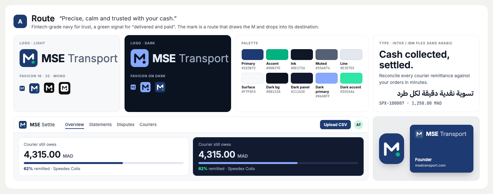

# MSE Transport brand

**MSE Transport** is a software suite for cash-on-delivery (COD) e-commerce logistics in Morocco.
It has three products:

| Product | What it does | Repo | Local URL |
|---|---|---|---|
| **MSE Dispatch** | Live parcel operations: orders, courier assignment, delivery attempts, customer SMS | spring-parcel-platform | http://localhost:3100 |
| **MSE Settle** | Courier cash settlement: remittance upload, reconciliation, balances, disputes | spring-cod-settlement | http://localhost:3200 |
| **MSE Copilot** | AI assistant that answers questions over settlement data, with checked figures | spring-ai-settlement-copilot | http://localhost:3300 |

This is direction **A, "Route"**. Directions B ("Momentum") and C ("Seal") were also explored and
are kept in `spring-cod-settlement/brand/directions/`. The brand source of truth is `spring-cod-settlement/brand/`; this folder is a copy.

## Personality

**Precise, calm and trusted with your cash.** MSE Transport moves parcels and money between
merchants, couriers and finance teams. The brand has to feel like a fintech you would trust with a
day's takings, while staying light enough for dispatchers who live in it all day.

## Logo

- **Mark** ([`logo/mse-mark.svg`](logo/mse-mark.svg)): a single route line that draws the **M**
  and then drops into a green **destination dot**: the parcel arriving, the cash coming back. It is
  one stroke and one dot, so it stays readable at 16 px.
- **Wordmark**: **MSE** in Inter Bold plus **Transport** in Inter Regular, in the muted colour.
  The letters are outlined as SVG paths, so the logo renders the same everywhere without the font.
- **Product lockup** in the apps: mark + **MSE** + product name in muted ("MSE **Settle**").
- Files in [`logo/`](logo/):

| File | Use |
|---|---|
| `mse-logo.svg` / `mse-logo-dark.svg` / `mse-logo-mono.svg` | Full logo on light, on dark, single colour |
| `mse-mark.svg` / `mse-mark-dark.svg` / `mse-mark-mono.svg` | Mark alone (app icon, avatar) |
| `mse-wordmark.svg` | "MSE" letters alone |
| `favicon.svg` | Favicon: thicker stroke for 16 px, switches to the dark version with the OS theme |

- On dark backgrounds the tile turns periwinkle (`#86A8FF`) and the route and dot turn ink, so the
  mark keeps its contrast.
- Clear space: half the mark's height on every side. Minimum size: 16 px (mark), 96 px wide (full logo).

## Colour

| Token | Light | Dark | Use |
|---|---|---|---|
| `accent` (Route navy) | `#1D3B72` | `#86A8FF` | Primary actions, active navigation, the main chart series |
| `signal` (signal green) | `#00B37E` | `#2EE6A6` | The logo dot, "delivered / paid" highlights, progress |
| `signal-ink` | `#007A56` | `#2EE6A6` | Green text (AA on white) |
| `success` / `warn` / `danger` / `info` | `#007A56` / `#B45309` / `#BE123C` / `#0369A1` | `#34D399` / `#FBBF24` / `#FB7185` / `#38BDF8` | Matched, mismatch, missing, informational |
| `bg` / `panel` / `subtle` / `line` | `#F7F8FA` / `#FFFFFF` / `#EEF1F5` / `#E3E7EE` | `#0B1220` / `#111A2E` / `#18233A` / `#22304D` | Surfaces and borders |
| `fg` / `muted` / `faint` | `#0E1726` / `#556074` / `#667085` | `#E8EEF8` / `#9AA8C0` / `#7D8AA3` | Text levels. All meet WCAG AA on their background |
| `chart-2` | `#A8B6CC` | `#3D4E6E` | Second chart series (for example "expected" next to "reported") |

Navy reads as a bank, not a trucking company. Green is used sparingly, as a signal ("it arrived,
it's paid"), never as a second primary. Status colours stay conventional (green, amber, red)
because finance users already read them that way.

Files: [`tokens.css`](tokens.css) (CSS variables for light and dark) and
[`tailwind.tokens.js`](tailwind.tokens.js) (Tailwind theme). The Angular app maps the same
variables in its Tailwind v4 `@theme` block.

## Typography

- **Inter** for all Latin UI text, **IBM Plex Sans Arabic** for Arabic. Both are on Google
  Fonts, both have tabular figures, and their x-heights sit well together. The React apps self-host
  them through Fontsource, so they work offline; the Angular app loads them from Google Fonts.
- **JetBrains Mono** for tracking numbers, IDs and amounts in tables, so the figures line up.
- Data screens use 13-14 px body text and 20-24 px page titles. Labels are uppercase 11 px with
  0.06 em tracking. Headings are Semibold (600); there are no black weights.
- English is the default, French is available everywhere. Layouts use logical properties
  (`ms-*`, `me-*`, `start`/`end`) so an Arabic RTL locale can be added without rewriting them.

## Icons

Lucide icons (React) and inline Lucide-style SVG (Angular): 2 px strokes, rounded caps, 16 px in
tables and buttons, 14 px in navigation. An icon goes next to a label, never instead of one. No
trucks, boxes or clip art in the brand itself.

## Voice

**Calm, exact, on the merchant's side.** It talks like a good finance colleague: how much, who owes
it, and what to do next.

| Do | Don't |
|---|---|
| "Speedex Colis still owes you 530.50 MAD." | "Balance delta: -530.5" |
| "3 lines need attention" | "3 anomalies detected!!" |
| "Amount mismatch" | `AMOUNT_MISMATCH` |
| "We couldn't find statement #12." | "404 Not Found" |
| Amounts always with MAD and two decimals | Rounded or float amounts |
| English or French, one language per sentence | Franglais |

## Do / don't

- **Do** keep one navy primary action per screen. **Don't** make every button navy.
- **Do** right-align money in mono. **Don't** colour amounts unless the colour means something (owed, mismatch).
- **Do** use green for "done / paid / delivered". **Don't** use it for decoration or for body text.
- **Don't** recolour, rotate, outline or add effects to the mark, or put the dot on a green background.
- **Don't** pair the logo with another logistics company's name or colours.

## Who it is for

- **Merchants** (Moroccan e-commerce brands) check between orders, on a laptop or tablet. They
  need the big numbers first and "who owes me what" in one sentence.
- **Dispatchers** work a live board all day: strong status colours, dense cards, dark mode.
- **Finance ops** spend hours in tables: low-glare neutrals, mono figures, keyboard focus everywhere.

## Name

Domains checked in Nov 2026 (whois lookup only): `msetransport.com`, `msetransport.ma` and
`msetransport.io` were unregistered at the time. Small unrelated US trucking firms use the name
"MSE Transport"; there was no conflict in Morocco or with MENA delivery and logistics brands.
