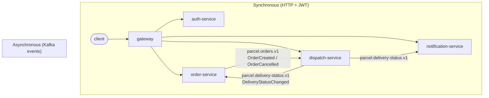
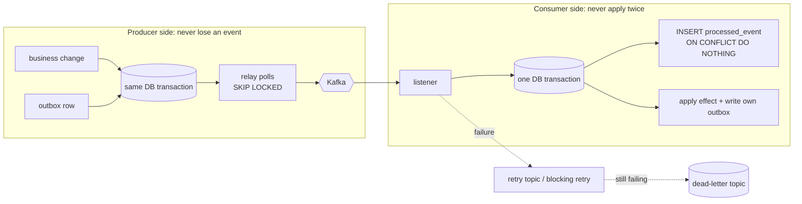
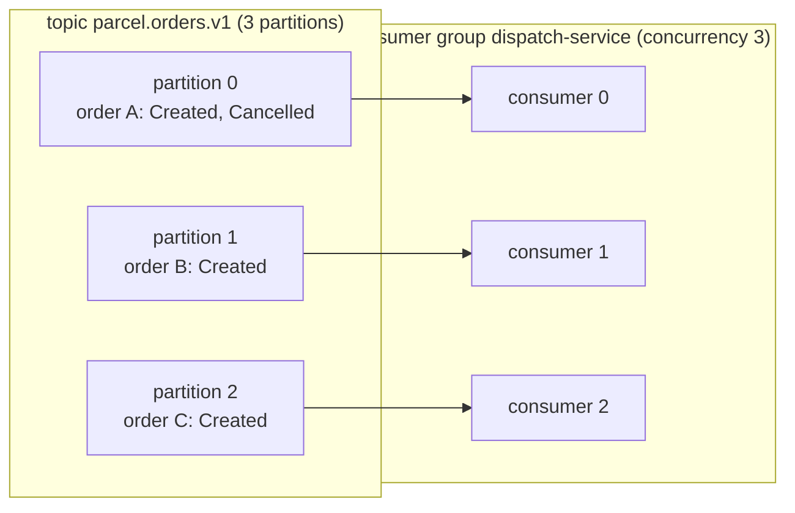
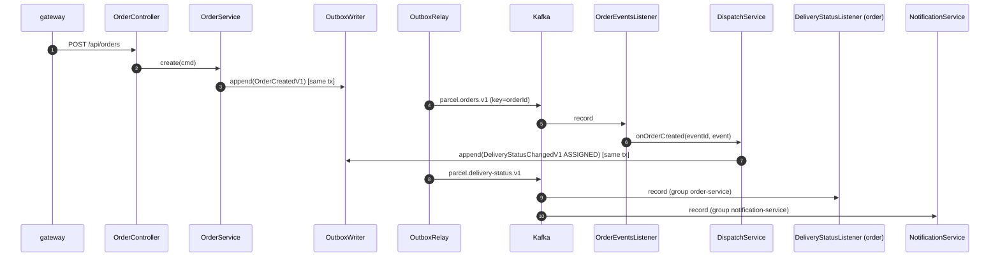

# Interview guide: spring-parcel-platform

For someone who already builds microservices with **NestJS, Bull/BullMQ and TypeScript** and wants to
explain this Java/Spring project with confidence. Diagrams first, text second.

---

## 1. The whole system on one page

**Commands go over HTTP. Facts go over Kafka.** A merchant *asks* to create an order (HTTP). Once the
order exists, order-service *announces the fact* `OrderCreated` (Kafka), and whoever cares reacts.

### The reliability recipe in one picture

Remember it as **outbox in, idempotency out, DLT for the rest**.

### Where each Kafka concept lives

* key = `orderId` → the same order always goes to the same partition → **ordered per order**.
* One partition is read by **one consumer per group** → parallelism = number of partitions.
* `parcel.delivery-status.v1` is read by **two groups** (`order-service`, `notification-service`).
  Each group gets its own full copy (pub/sub). Inside a group, the work is split (queue).

---

## 2. NestJS / Bull / BullMQ → Spring Kafka

| You know (Node) | Here (Spring) | Where in this repo |
|---|---|---|
| `@nestjs/microservices` `ClientKafka.emit()` | `KafkaTemplate.send(topic, key, value)` | `service-support/.../OutboxRelay.java` |
| `@EventPattern('order.created')` | `@KafkaListener(topics = ..., groupId = ...)` | `dispatch-service/.../OrderEventsListener.java` |
| Bull `queue.add(job)` | Producing a record (but Kafka keeps it, it is a log, not a job queue) | outbox relay |
| Bull `process()` worker | `@KafkaListener` method, run by a listener container | all `*Listener.java` |
| Worker `concurrency: 3` | `@KafkaListener(concurrency = "3")`, capped by the partition count | `OrderEventsListener` |
| Job `attempts: 4, backoff` | `@RetryableTopic(attempts = "4", backoff = @Backoff(1000))` or `DefaultErrorHandler(ExponentialBackOff)` | dispatch / `KafkaErrorHandling.java` |
| Failed jobs list | Dead-letter topic (`-dlt`) + `@DltHandler` | `OrderEventsListener.onDeadLetter` |
| `jobId` for dedup | `eventId` in the envelope + `processed_event` table | `IdempotencyGuard.java` |
| BullMQ group/rate limit | Partitions + consumer groups; Redis rate limiter at the gateway | `gateway/application.yml` |
| Job completed → removed | Offset committed; the record stays on the topic until retention | `ack-mode: record` |
| Redis as the broker | Kafka is a replicated, partitioned **log**; consumers can replay | n/a |
| NestJS `Guard` + `@Roles()` | Spring Security filter chain + `@PreAuthorize("hasRole('OPS')")` | `OrderController`, `DeliveryController` |
| `passport-jwt` with JWKS (`jwks-rsa`) | `spring-boot-starter-oauth2-resource-server` + `jwk-set-uri` | `ResourceServerSecurityConfig.java` |
| `class-validator` DTO | Bean Validation `@NotBlank @Pattern` on records + `@Valid` | `OrderDtos.java` |
| Exception filter | `@RestControllerAdvice` returning `ProblemDetail` | `GlobalExceptionHandler.java` |
| TypeORM / Prisma migrations | Flyway `V1__*.sql` + JPA entities, `ddl-auto: validate` | `src/main/resources/db/migration` |
| `@Injectable()` + module DI | `@Service` / `@Component` + constructor injection | everywhere |
| `nestjs-cls` / AsyncLocalStorage request id | SLF4J **MDC** (`CorrelationId`) + Kafka header | `CorrelationIdFilter`, `KafkaCorrelationInterceptor` |
| `opossum` circuit breaker | Resilience4j `CircuitBreaker` + `Retry` + `TimeLimiter` | `SmsGatewayClient.java` |
| `@nestjs/terminus` health | Spring Boot Actuator `/actuator/health/readiness` | compose healthchecks |
| `prom-client` | Micrometer + `/actuator/prometheus` | `OrderService`, `OutboxRelay` counters |
| Jest + `testcontainers` npm | JUnit 5 + Mockito + Testcontainers Java | `*IntegrationTest.java` |
| `@nestjs/schedule` `@Interval` | `@Scheduled(fixedDelayString = ...)` + `@EnableScheduling` | `OutboxRelayScheduler.java` |

**Main mindset shift from Bull:** Bull deletes a job once it is done. Kafka keeps the log, and each
consumer group only moves its **offset**. That is why you can add notification-service later and
replay history, and why "processed" has to be tracked by you (idempotency), not by the broker.

---

## 3. One order, end to end, file by file

| # | Step | File |
|---|---|---|
| 1 | Request enters, JWT checked, rate limited, `X-Correlation-Id` created | `gateway/.../GatewaySecurityConfig.java`, `RateLimitConfig.java`, `CorrelationIdGlobalFilter.java`, `gateway/src/main/resources/application.yml` (routes) |
| 2 | Correlation id put in MDC for every log line | `service-support/.../correlation/CorrelationIdFilter.java` |
| 3 | JWT validated again by the service, roles mapped | `service-support/.../security/ResourceServerSecurityConfig.java`, `JwtRolesConverter.java` |
| 4 | DTO validated, merchantId taken from the token (never from the body) | `order-service/.../web/OrderController.java`, `OrderDtos.java` |
| 5 | Idempotency-Key check, `Order.create`, save | `order-service/.../application/OrderService.java`, `domain/Order.java` |
| 6 | `OrderCreatedV1` wrapped in an envelope, saved as an outbox row **in the same transaction** | `service-support/.../messaging/OutboxWriter.java`, `common-events/.../EventCodec.java` |
| 7 | Relay claims rows with `FOR UPDATE SKIP LOCKED`, sends with key = orderId and headers, marks published | `OutboxRelay.java`, `OutboxRepository.java`, `OutboxRelayScheduler.java` |
| 8 | dispatch consumes; correlation id restored from the header | `dispatch-service/.../messaging/OrderEventsListener.java`, `KafkaCorrelationInterceptor.java` |
| 9 | Envelope decoded, type and version checked; bad input → `InvalidEventException` → DLT | `EventCodec.java` |
| 10 | Dedup (`processed_event`), city → zone, least-loaded courier, `Delivery.assign` | `DispatchService.onOrderCreated`, `IdempotencyGuard.java`, `Zones.java`, `CourierAssignmentPolicy.java`, `Delivery.java` |
| 11 | `DeliveryStatusChangedV1(ASSIGNED, sequence=1)` written to dispatch's outbox | `DispatchService.publish` |
| 12 | order-service projects it (dedup + sequence guard) → order `ASSIGNED` | `order-service/.../messaging/DeliveryStatusListener.java`, `DeliveryStatusProjector.java`, `Order.applyDeliveryStatus` |
| 13 | notification-service renders text and sends it on every channel | `notification-service/.../messaging/DeliveryStatusListener.java`, `NotificationService.java`, `MessageTemplates.java` |
| 14 | SMS through Retry → CircuitBreaker → TimeLimiter; result saved per channel | `SmsGatewayClient.java`, `SmsConfig.java`, `application.yml` (`resilience4j.*`) |
| 15 | Courier calls `/out-for-delivery` and `/delivered`: state machine checks, ownership check, new events | `DeliveryController.java`, `DispatchService.outForDelivery/delivered`, `DeliveryStatus.java` |
| 16 | Failure path: third `/failed` emits FAILED + RETURNED (compensation) | `Delivery.markFailed` |

Talk track (60 seconds): *"The merchant's POST only writes to order-service's database: the order
and an outbox row, in one transaction. A relay publishes the outbox to Kafka, keyed by order id so
events stay ordered per order. dispatch-service consumes it idempotently, picks the least-loaded
courier in the parcel's zone, and writes its own outbox event. Two consumer groups read that status
event: order-service updates the merchant view, notification-service sends the SMS behind a circuit
breaker. Every hop is at-least-once, every consumer is idempotent, and anything unprocessable ends up
in a dead-letter topic."*

---

## 4. Thirty likely questions, with short answers tied to this code

### Microservices

**1. Why microservices here and not a modular monolith?**
Order intake, dispatch and messaging scale and change differently (notification bursts at delivery
time, dispatch logic changes weekly). Each owns its data, so they can be deployed and scaled on their
own. Honest answer: for a small team I would start as a modular monolith with the same boundaries.
This repo shows how the boundaries look once they are split.

**2. Why a database per service? Isn't one Postgres simpler?**
Shared tables create hidden coupling: one team's migration breaks another service. Here each service
has its own database (`authdb`, `orderdb`, ...) and shares data only through events and APIs. The
compose file uses one Postgres *instance* to save RAM, but the services cannot see each other's
tables.

**3. How does order-service know a parcel was delivered without calling dispatch?**
It subscribes to `DeliveryStatusChanged` and keeps a local projection (`Order.applyDeliveryStatus`).
That is event-carried state transfer. Reads stay local and fast, and still work when dispatch is down.

**4. What is the API gateway for, and what does it NOT do?**
One entry point: routing, JWT validation, rate limiting (Redis token bucket per user or IP), and
correlation ids. It does **not** do business authorisation. "A courier can only drive their own
delivery" is checked in dispatch-service, which knows the data.

**5. How do you handle a request that spans services: a distributed transaction?**
No 2PC. Each service commits locally and publishes events (outbox). The overall process is a
**saga**. The failed-delivery flow ends with the compensating `RETURNED` step. It is choreographed
(services react to events). An orchestrator such as Temporal fits better when there are many branches
and timeouts.

### Kafka

**6. Topic, partition, offset: explain them with this project.**
`parcel.orders.v1` is a topic with 3 partitions. Each partition is an append-only log. An offset is a
consumer group's position in one partition. dispatch-service commits its offset after
`onOrderEvent` returns (`ack-mode: record`).

**7. How is ordering guaranteed?**
Only within a partition. All events of one order share the key `orderId`, so they share a partition.
The relay also stops at the first send failure, so it never publishes event 2 before event 1. Retry
topics and redeliveries can still reorder, so `DeliveryStatusChanged.sequence` lets order-service
drop stale events.

**8. What is a consumer group, and what happens if I run 5 dispatch instances with 3 partitions?**
A group shares the partitions: each partition goes to exactly one member. With 5 members and 3
partitions, 2 sit idle (hot standby). To scale further, add partitions (this re-keys future data, so
plan it). Different groups (`order-service` and `notification-service` on the status topic) each get
every message.

**9. What happens during a rebalance?**
Partitions move between members. Uncommitted records can be delivered again to the new owner. That
is one of the reasons consumers must be idempotent.

**10. At-most-once, at-least-once, exactly-once: which one here and why?**
At-least-once: commit the offset *after* processing, and publish via the outbox (which can re-send).
At-most-once (commit first) would lose parcels. Kafka's exactly-once (idempotent producer +
transactions + `read_committed`) only covers Kafka-to-Kafka. We also write to Postgres, so we use
**at-least-once + idempotent consumers = effectively once**.

**11. How does the idempotent consumer work exactly?**
`IdempotencyGuard.firstDelivery` runs `INSERT INTO processed_event (event_id, consumer) ... ON CONFLICT
DO NOTHING` **in the same transaction** as the business change. 1 row means first time, so process.
0 rows means duplicate, so skip. If processing fails, the insert rolls back too, so a retry is not
wrongly skipped. Tested in `DispatchKafkaIntegrationTest.sameEventDeliveredTwice...`.

**12. Blocking retries vs retry topics?**
Blocking (`DefaultErrorHandler`, order-service): retry in place and keep partition order, but the
partition stalls. Non-blocking (`@RetryableTopic`, dispatch): the failed record moves to
`parcel.orders.v1-retry` and the next orders keep flowing, but ordering is lost for that record.
Pick per use case. Both end in a DLT.

**13. What is a poison message and how do you handle it?**
A record that can never succeed (bad JSON, missing `orderId`, future schema version). Retrying it
blocks or wastes work. `EventCodec` throws `InvalidEventException`, which is registered as
non-retryable, so it goes straight to the DLT with the exception in the headers
(`kafka_dlt-exception-cause-fqcn`). Ops can inspect it, fix it and replay it.

**14. Why `acks=all` and `enable.idempotence=true` on the producer?**
`acks=all` means the write is on all in-sync replicas before it is acknowledged (no loss if the
leader dies). The idempotent producer removes duplicates caused by the producer's own retries. It
does not remove duplicates caused by the outbox re-sending a row. That is the consumer's job.

**15. How would you evolve an event schema?**
Additive changes stay `V1`: the tolerant reader ignores unknown fields and maps unknown enums to
`UNKNOWN` (tested in `EventCodecTest`). Breaking changes get `OrderCreatedV2` and a bumped
`schemaVersion` (consumers upcast or reject it), or a new topic `parcel.orders.v2`. Next step:
Schema Registry + Avro with compatibility checks in CI.

**16. Why KRaft instead of ZooKeeper?**
Since Kafka 3.3, KRaft (Raft-based metadata inside Kafka) is production-ready, and ZooKeeper is
removed in Kafka 4.0. There is one less system to run and secure, and controller failover is faster.
The compose broker is `broker,controller` in one process.

### Outbox

**17. What problem does the outbox solve? Why not send to Kafka in the service method?**
The dual write. If you `save()` then `kafkaTemplate.send()` and the process dies in between, the
order exists but nobody hears about it. If you send first and the commit fails, consumers react to a
ghost order. With the outbox, one local transaction holds both. Note `Propagation.MANDATORY` in
`OutboxWriter`.

**18. How does the relay avoid double-publishing with 3 replicas?**
`SELECT ... FOR UPDATE SKIP LOCKED LIMIT 100`: each replica locks a different batch, and nobody
waits. Some duplicates are still possible (crash after the send, before the UPDATE). Consumers absorb
them.

**19. Polling relay vs Debezium?**
Polling is simple, needs no extra infrastructure, and adds about 300 ms of latency plus a little DB
load. Debezium reads the Postgres WAL (CDC), so latency is lower and nothing polls, but you have
Kafka Connect to run. I would move to Debezium when volume grows. The table design stays the same.

**20. How do you stop the outbox table from growing forever?**
`OutboxRelayScheduler.purge` deletes published rows older than 7 days (nightly cron). The partial
index `WHERE published_at IS NULL` keeps the hot query fast however big the table gets.

### Resilience

**21. Explain the circuit breaker states with the SMS example.**
CLOSED: calls go through and results are recorded in a sliding window of 10. If 50% or more of at
least 5 calls fail, it goes **OPEN**: calls fail immediately (`CallNotPermittedException` →
`SKIPPED`) for 30 s, so threads are not wasted and the provider can recover. Then **HALF_OPEN**: 2
trial calls decide between CLOSED and OPEN again. Test:
`SmsGatewayClientTest.circuitOpensAfterRepeatedFailures...`.

**22. Why Retry outside CircuitBreaker, and what do you retry?**
Each retry attempt is counted by the breaker, so a dying provider opens it quickly, and once it is
open the retry stops (`CallNotPermittedException` is ignored by the retry). Retry 5xx, IO errors and
timeouts with exponential backoff. Never retry 4xx: the request itself is wrong.

**23. Why a TimeLimiter if the HTTP client already has timeouts?**
Defence in depth, and an upper bound on the *whole* call (DNS, connect, read). It is also measured
by the breaker as a failure. A slow provider is often worse than a dead one, because it holds threads.
Test: `slowProviderIsCutOffByTheTimeLimiter`.

**24. The SMS call is inside the DB transaction: is that bad?**
It is a known trade-off, written down in `NotificationService`. It is bounded (2 s × 3 attempts) and
senders never throw. The alternative is to save a `PENDING` notification, commit, and send from a
separate worker (an outbox for outgoing SMS). That is the next step if SMS volume grows.

**25. What happens to deliveries if Kafka is down for 10 minutes?**
Orders are still accepted: they only need Postgres. Outbox rows pile up (`parcel_outbox_pending`
metric, so alert on it). When Kafka comes back, the relay drains them in order. That is the outbox
acting as a buffer.

### Security

**26. Why RS256 and JWKS instead of a shared HS256 secret?**
With HS256, every service that verifies tokens can also forge them. With RS256, only auth-service
has the private key, and everyone else gets the public key from `/.well-known/jwks.json` (cached;
the `kid` header picks the key, which allows rotation). Services verify locally, with no network call
per request.

**27. Is the JWT validated only at the gateway?**
No. The gateway validates it (signature, expiry, issuer), and every service validates it again as an
OAuth2 resource server. If someone reaches a service directly inside the network, they still need a
valid token. Test: `GatewayIntegrationTest.tokenFromWrongIssuerOrForeignKeyIsRejected`.

**28. How do you stop a merchant reading another merchant's orders?**
`merchantId` comes from the token claim, never from the request body. `OrderService.getVisible`
filters by owner and returns **404, not 403**, so it does not reveal that the order exists. Couriers
get 403 on deliveries that are not theirs (`DispatchService.forActor`).

**29. How would you revoke a token?**
JWTs are stateless, so: short expiry (1 h here, minutes in production) plus refresh tokens, and a
deny-list of `jti` values in Redis checked at the gateway for urgent revocation. In production,
Keycloak handles refresh, rotation and sessions.

### Testing

**30. Why Testcontainers instead of H2 or embedded Kafka?**
H2 does not support `FOR UPDATE SKIP LOCKED` or `ON CONFLICT DO NOTHING` the way Postgres does, and
those two lines are the core of the outbox and the idempotency guard. Testcontainers runs the **real**
`postgres:16-alpine` and `apache/kafka:3.8.0` (KRaft), so the tests exercise exactly what production
runs: Flyway migrations, transactions, partitions, the DLT. Containers are started once per test
class (static fields), and `@ServiceConnection` / `@DynamicPropertySource` wire them in. The same
tests run in GitHub Actions, where Docker is available.

---

## 5. Numbers and names to remember

* 5 services + 2 libraries, 7 Maven modules, Java 21, Spring Boot 3.3, Spring Cloud 2023.0.
* Topics: `parcel.orders.v1` (3 partitions), `parcel.delivery-status.v1` (3 partitions), retry and
  DLT topics.
* Max delivery attempts: 3, then RETURNED.
* Circuit breaker: window 10, minimum 5 calls, 50% failures, open 30 s. Retry: 3 attempts, 200 ms × 2.
  Timeout: 2 s.
* Rate limit: 20 req/s per user, burst 40.
* Outbox relay: every 300 ms, batches of 100, purge after 7 days.

## 6. If they ask "what would you improve?"

Schema Registry + Avro, Debezium for the outbox, Keycloak, Kubernetes with KEDA scaling on consumer
lag, contract tests, a settlement service that reconciles collected cash with `DELIVERED` events,
and alerts on `parcel_outbox_pending`, DLT growth and the circuit breaker state.
