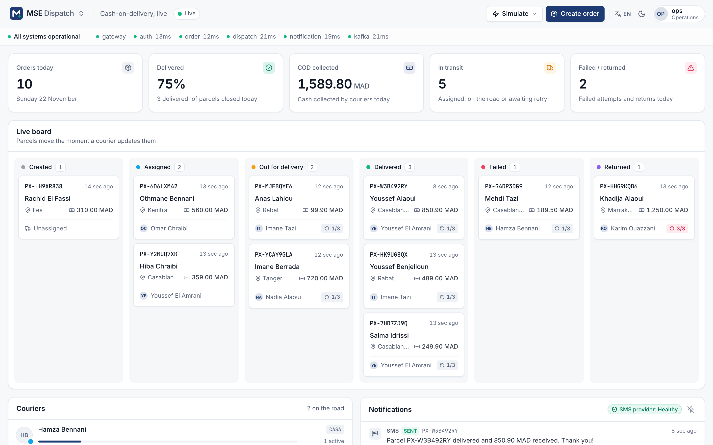
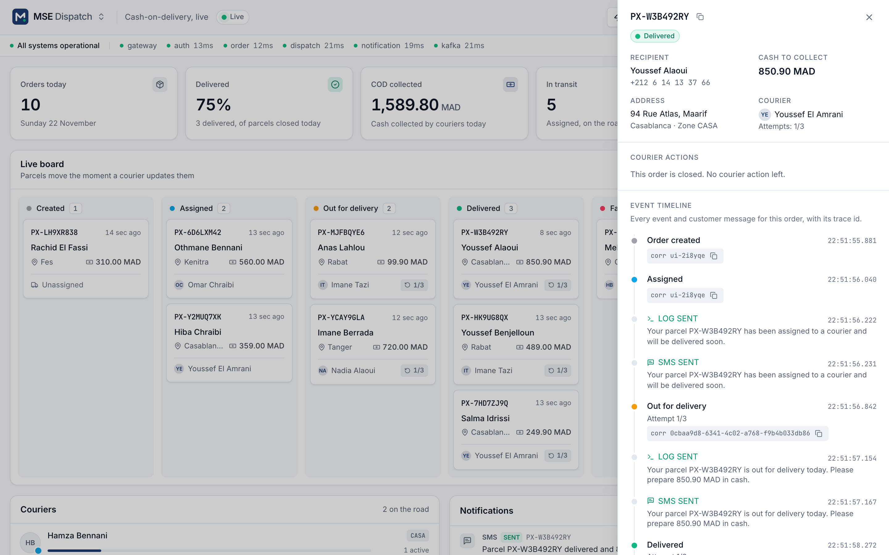
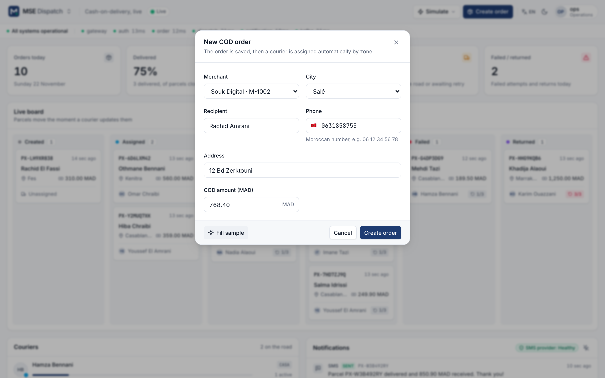

# MSE Dispatch: product overview



**MSE Dispatch** is the parcel operations product of **MSE Transport**, a software suite for
cash-on-delivery (COD) logistics in Morocco (with MSE Settle for courier cash settlement and MSE
Copilot for questions over settlement data).

## The problem

COD delivery is a long, failure-prone process. Order intake, dispatch and customer messaging move at
different speeds; no step may be lost, or a parcel sits in the warehouse forever; messages arrive
twice; the SMS provider will be down at some point; and many first delivery attempts fail (customer
absent, phone off, refused), so a parcel may need several tries before it goes back to the merchant.
Operations teams need to see all of this as it happens.

## What MSE Dispatch does

- **Order intake** with Moroccan addresses and phone numbers, COD amounts in MAD, and safe retries
  (an idempotency key makes a repeated request harmless).
- **Automatic courier assignment** by zone, least-loaded courier first.
- **Delivery attempts**: out for delivery, delivered (cash collected), failed and retried, and
  returned to the merchant after the last attempt.
- **Customer SMS** at each step, with a fallback channel when the SMS provider fails.
- **A live operations console**: board by status, KPIs for the day, courier load, customer
  messages, service health, and each order's full timeline, in English or French, light or dark.

| Order timeline | New order |
|---|---|
|  |  |

## How it is built

- **Services**: gateway (Spring Cloud Gateway, JWT check, rate limiting), auth (RS256 JWT + JWKS),
  order, dispatch and notification services, each with its own PostgreSQL database.
- **Events**: Kafka (KRaft) with a transactional outbox; idempotent consumers; retry topics and
  dead-letter topics.
- **Resilience and observability**: Resilience4j (retry, time limiter, circuit breaker) at the SMS
  edge; Micrometer, Prometheus and OpenTelemetry tracing with one correlation id end to end.
- **Console**: React 18, TypeScript, Tailwind with the MSE Transport design tokens, TanStack Query,
  framer-motion; live updates over Server-Sent Events.
- **Delivery**: Docker Compose for the whole platform, GitHub Actions CI.

## Key engineering decisions

- **Transactional outbox** instead of writing to the database and Kafka separately: an order is
  never saved without its event, and no event is published for a rolled-back order.
- **At-least-once delivery plus idempotent consumers**, rather than chasing "exactly once": a
  repeated event never assigns a courier twice or sends two SMS.
- **A saga for failed deliveries**: attempts, retries and the return to the merchant are a
  long-running process with a compensating step, not one transaction.
- **The SMS provider cannot stop deliveries**: a circuit breaker opens on failures while the log
  channel keeps working.
- **Live console without polling**: one SSE stream fed by its own Kafka consumer group, events
  stored once so a redelivered event never moves a card twice; a short-lived, single-purpose token
  for the stream.

## Quality

| Suite | Count |
|---|---|
| Java tests across the six services (JUnit 5, Mockito, `@WebMvcTest`, Testcontainers Postgres, Kafka and Redis) | 164 |
| Console tests (Vitest + Testing Library) | 26 |
| Browser end-to-end (Playwright: sign in, create an order, simulate the delivery, see it delivered live) | 1 |

All suites run in CI on every push.

## Try it

```bash
docker compose up -d --build     # http://localhost:3100, sample account ops / Passw0rd!
./scripts/seed-dashboard.sh      # optional: orders in every column
```
