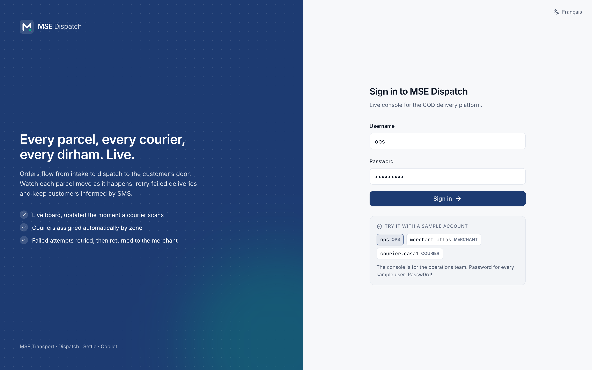
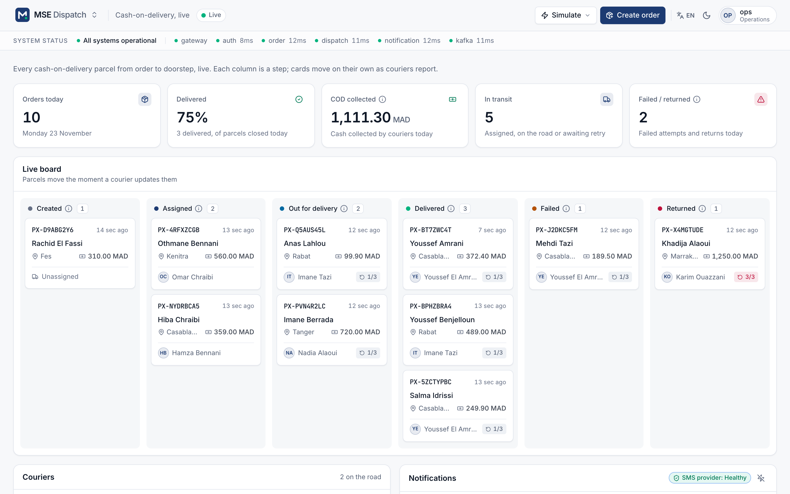
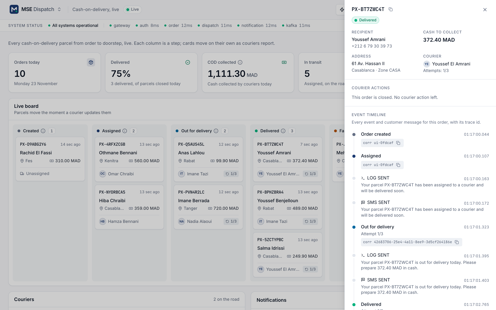
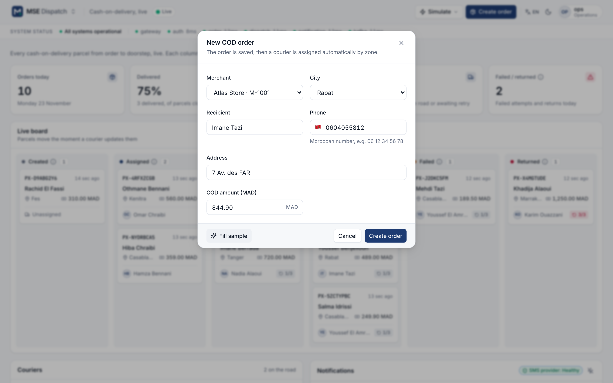
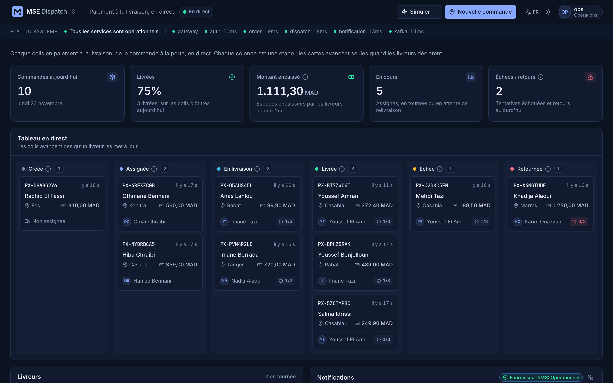

# MSE Dispatch: the 2-minute tour

MSE Dispatch runs cash-on-delivery parcels from the order to the customer's door. Start it with
`docker compose up -d --build`, wait about a minute, run `./scripts/seed-dashboard.sh`, and open
http://localhost:3100.

## 1. Sign in

The operations account `ops` is filled in. Click **Sign in**.

## 2. Read the board

- **System status** (top strip): every part of the platform is up.
- **Five numbers for today**: orders, share delivered, cash collected (COD), parcels in transit, failures and returns.
- **The live board**: one column per step, left to right: *Created → Assigned → Out for delivery →
  Delivered*, or *Failed* (it will be retried) and finally *Returned* to the merchant. Hover the ⓘ
  next to a column name for what it means. The **1/3** badge on a card is the delivery attempt
  number out of the maximum.

## 3. Watch a parcel move

Click **Simulate → New order, delivered**. The card appears in *Created*, is assigned to a courier in
the right zone about a second later, then moves to *Out for delivery* and *Delivered*. The numbers,
courier load and customer messages update with it. **Simulate → New order, failed 3 times** shows a
parcel that goes back to the merchant.

## 4. Open a parcel

Click any card: recipient, cash to collect, courier, attempts, and the timeline of every step and
every SMS sent to the customer.

## 5. Create an order

**Create order** opens a form with Moroccan cities and phone formats; **Fill sample** fills it for you.

## 6. In French, in the dark

The language and theme switches are in the header. Account menu → **How it works** shows how
Dispatch fits with MSE Settle (the cash) and MSE Copilot (the questions).

